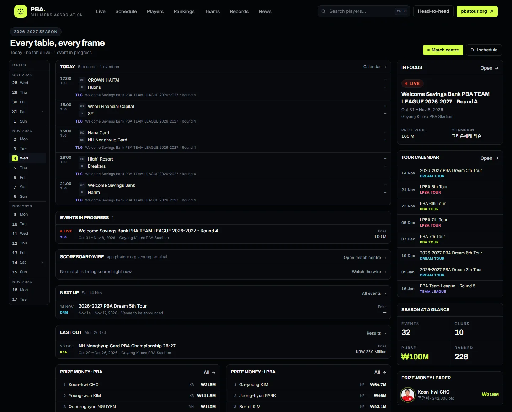
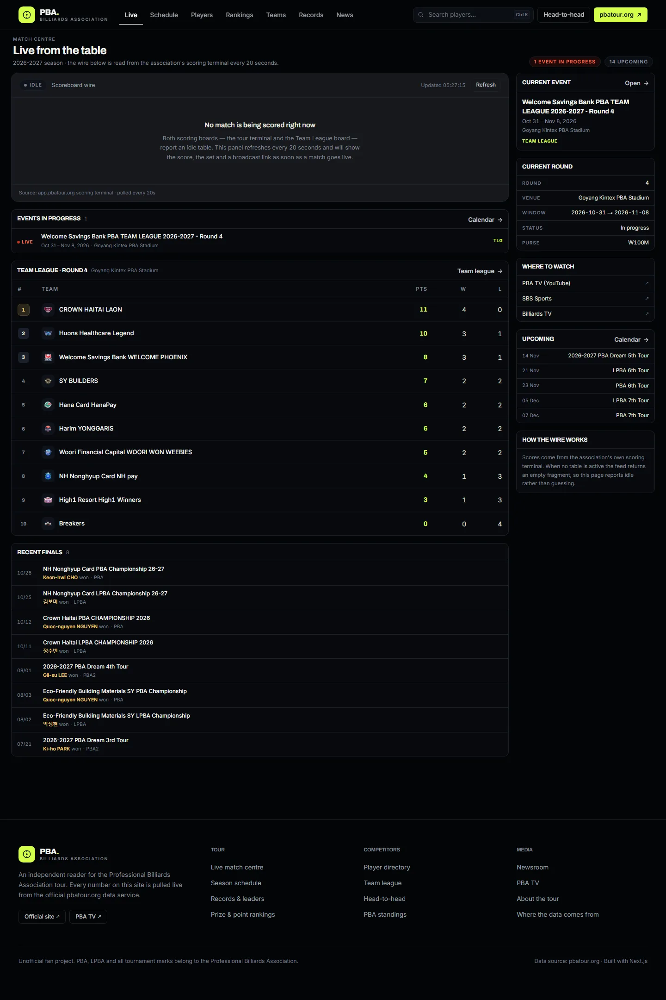
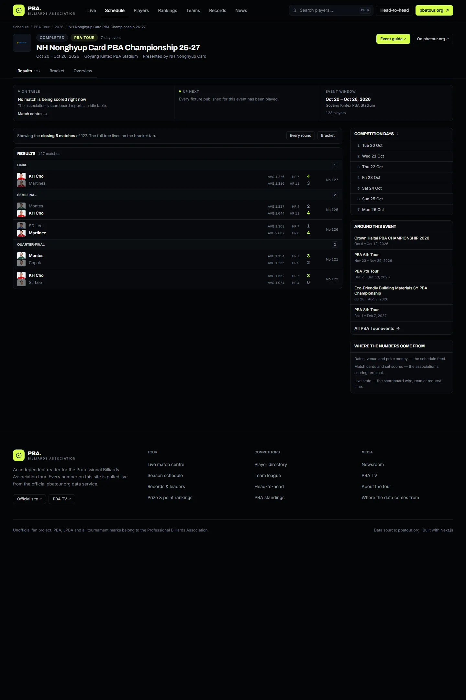
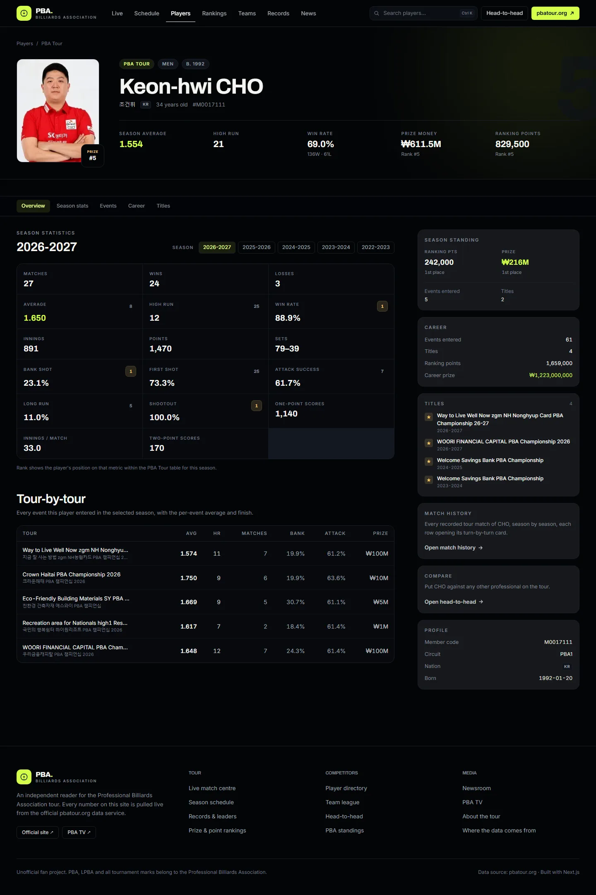
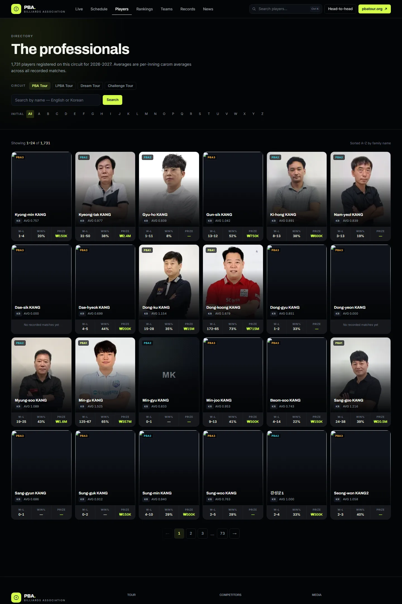
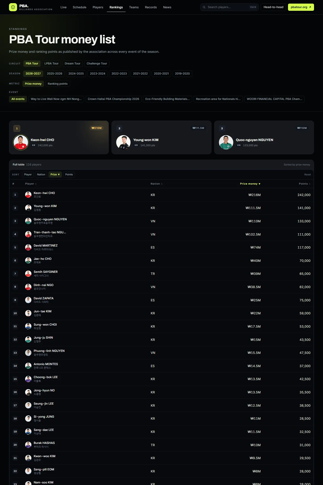
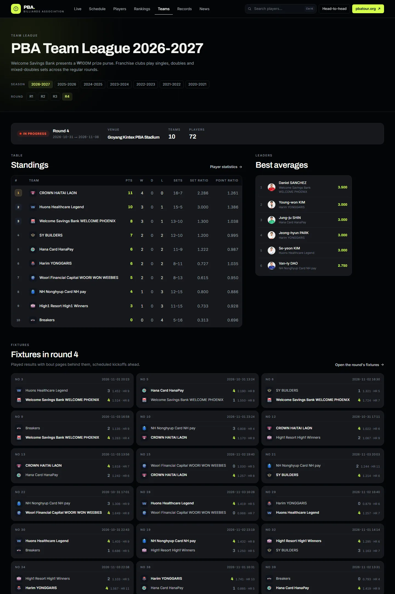
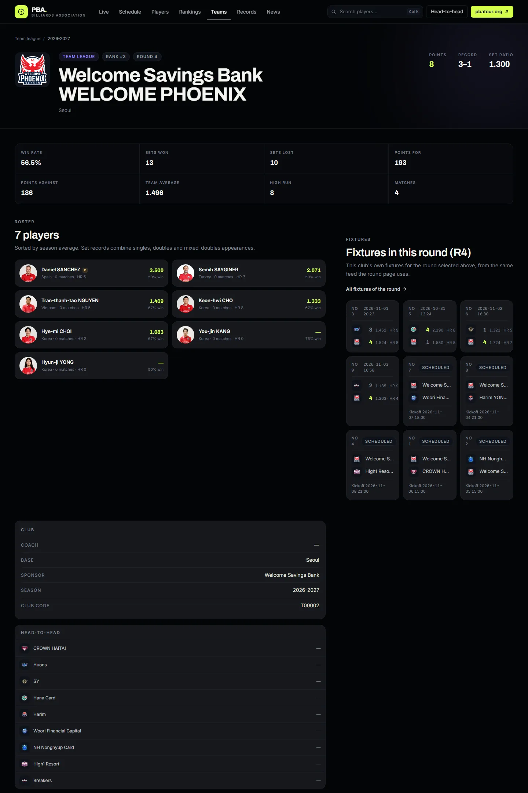
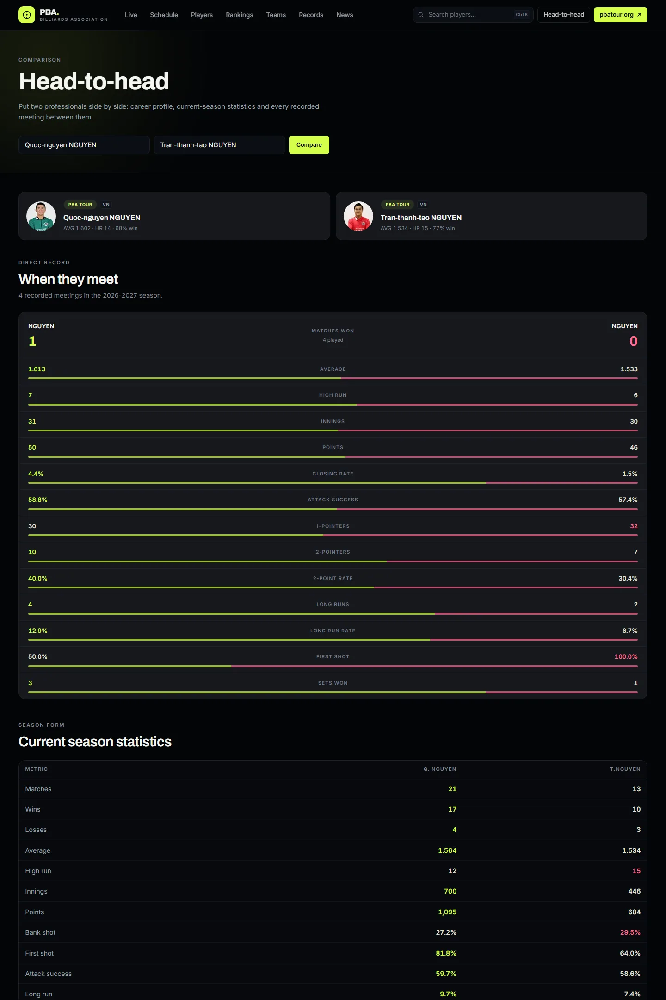
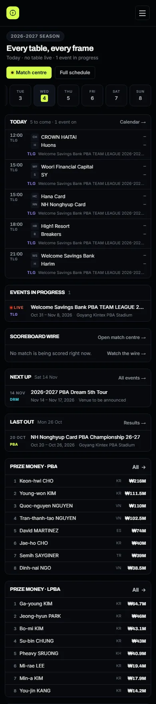

# PBA Hub

[](https://github.com/braces157/PBAVN/actions/workflows/ci.yml)

A fast, readable web client for the **Professional Billiards Association** (PBA) tour —
live scoreboard, player statistics, team-league tables, rankings, the full calendar and
the record book.



Every number on the site is read at request time from the association's own public data
service (`pbatour.org`). Nothing is hand-entered, scraped into a warehouse, or estimated.

- **Stack:** Next.js 15 (App Router) / React 19 / TypeScript / Tailwind CSS v4
- **Data:** pbatour.org JSON API + the legacy scoreboard on app.pbatour.org
- **Language:** English UI, with original Korean retained where it identifies a person

---

## A look around

| **Match centre** | **Event page** |
| --- | --- |
|  |  |
| **Player profile** | **Player directory** |
|  |  |
| **Prize rankings** | **Team league** |
|  |  |
| **Club page** | **Head-to-head** |
|  |  |

<p align="center">
  <br>
  <sub>Responsive down to 390px — dense tables tighten their padding rather than clipping.</sub>
</p>

Screenshots are captured from a running dev server with `node scripts/shot.mjs
<url> <out.png> [width] [height]` (headless Chrome on port 9222).

---

## Quick start

```bash
npm ci
npm run dev        # http://localhost:3100
```

Production:

```bash
npm run build
npm start          # http://localhost:3100
```

Requires Node 20.9+ to run the site, and Node 22.6+ for `npm test`, `npm run
refresh-data` and `npm run build-calendar`, which run TypeScript sources directly through
Node's type stripping (built and tested on Node 22 and Node 25).

To check the site the way CI does, with a browser driving the real pages:

```bash
npm run lint       # tsc --noEmit
npm test           # parser and analytics suites, no network
npm run build
npm start &        # in another terminal
npm run verify     # launches headless Chrome, asserts 25 interactions
```

`npm run refresh-data` rebuilds the two committed translation lookups described in
[docs/DATA.md](docs/DATA.md). CI fails when they are stale. `npm run build-calendar`
rebuilds the committed event calendar the console reads; `refresh-data` runs it too.

---

## Reading the site

The web client is laid out like a scoreboard site rather than a brochure: the reader is
usually mid-tournament and wants to know what is on now, what is next, and what happened,
in that order. Three shapes carry that across every page.

- **A date rail** down the left of `/` and `/schedule`, so a day is one click away and the
  page never spends a screen explaining itself.
- **A scoreboard row** — a 42 px state gutter (live / date / kickoff), the two sides with
  crests, the score right-aligned in a tabular column, and a per-set strip beside it. It
  is the same row for a scheduled, live and finished match.
- **Panels** with a one-line title bar, used for every block below the fold.

An event page opens on **now and next** before it opens on results: a live block when the
scoring terminal reports a table in play, the next unplayed fixture with its distance
("Today 18:30", "Tomorrow", "Thu 05 Nov"), and the event window. Results, the full draw
and event facts hang off a tab strip (`Results / Bracket / Overview`) instead of stacking
into one long column.

## What's in the site

| Route | What it shows |
| --- | --- |
| `/` | Scoreboard index: date rail, today's matches, live wire, next up, last out, prize tables, team-league standings, season leaders, news |
| `/live` | Scoreboard wire (polled every 20s), events in progress, current team-league round, recent finals, broadcast links |
| `/schedule` | Calendar with a date rail, season and circuit selectors, the day's matches, upcoming and results by month |
| `/schedule/[seq]` | One event: now/next strip, results by round, full bracket, round fixtures, event facts, competition days |
| `/players` | 1,700+ professionals, searchable by name (English or Korean), filterable by circuit and initial |
| `/players/[memCode]` | Player profile: season stats with per-metric rank, tour-by-tour results, titles, career totals |
| `/players/[memCode]/matches` | Player match history: every recorded individual-tour match of a season, newest first, each row linking to its match card |
| `/rankings` | Prize-money and ranking-point tables, filterable by circuit, season and individual event |
| `/teams` | Team league: round selector, standings, best averages, all ten clubs |
| `/teams/[code]` | Club page: roster, team statistics, head-to-head record against every rival |
| `/teams/matches` | Team-league round fixtures: every fixture of the selected round, played results and scheduled kickoffs |
| `/teams/matches/[gameNo]` | One fixture: score board, bout-by-bout list, and the per-inning record of a selected bout |
| `/teams/players` | Every team-league player, sortable by average, win rate, high run and more |
| `/records` | Season category leaders (26 categories) plus the full roll of honour |
| `/compare` | Head-to-head: how two players compare and every recorded meeting between them |
| `/news` | Press releases, PBA TV video and photo galleries |
| `/news/[seq]` | Article body (sanitised CMS HTML) |
| `/about` | Circuits explained, and the exact endpoint list behind every figure |

---

## How the data layer works

There was no published API. The client was reverse-engineered from the official front
end, which turns out to be an undocumented JSON service behind a legacy Angular/Java
stack. The full record — every endpoint consumed, the two live scoreboards, the parser
rules for the scoring terminal, the event calendar, today's-matches read, the translation
artefacts and the photo pipeline — lives in [docs/DATA.md](docs/DATA.md).

The shape of it:

- **One JSON surface, one scoring terminal.** Stats and schedule come from a tidy JSON
  service; what happened on the table comes from a legacy ASP terminal that answers with
  HTML fragments, parsed into typed rows and cross-checked against published totals
  (`npm test`).
- **Two live boards, merged.** Tour circuits score on one surface and the Team League on
  another; `/live` reads both behind one shape, and reports "idle" when no table is
  active rather than inventing a match.
- **The server does the asking.** The upstream sends no CORS headers and its TLS chain
  omits the intermediate certificate, so `src/lib/pba/http.ts` fetches from Next.js
  server-side — plain `fetch` first for cacheability, a `node:https` fallback with the
  pinned intermediate on TLS failure, verification never disabled.
- **Degrade, don't die.** Every upstream call resolves to `null` on failure, with
  per-endpoint revalidation windows (60s live, 15 min stats, 24 h lists); pages that
  recorded failed reads say so with the partial-data notice.
- **Committed artefacts for the expensive reads.** The 783 KB player directory and the
  champion-name lookups are snapshotted into `src/lib/pba/data/*.json` and regenerated
  with `npm run refresh-data`; CI fails when they go stale.

---

## Interface

Built against what the strongest stats products do: HLTV's sortable tables with a rank
beside every figure, FotMob and SofaScore's header search and persistent sub-navigation.

- **Global player search** in the header, reachable with `⌘K` or `Ctrl+K`. Typing ranks a
  frozen 1,700-record index in memory, so results appear with no network hop. It ignores
  hyphens, accents and spacing, so `Ga-young`, `Gayoung` and `ga young` all find the same
  player.
- **Every table sorts.** One table component backs the rankings, the team-league
  standings and the player lists. Click any column header or the sort bar. Ranks renumber
  to follow the sort, the way a leaderboard should. Sorting happens in the browser over
  rows the server already rendered, so it is instant and the page stays shareable.
- **Sticky column headers.** Tables that run long scroll inside their own box with the
  header pinned, and the site header never collides with it.
- **In-page navigation** on player profiles, so a four-thousand-pixel page can be jumped
  through by section instead of scrolled.
- **Every player is clickable**, including the team-league rosters and standings that
  used to be dead ends.

## Project layout

```
src/
  app/                     route segments (all server components except the live board)
    api/live/route.ts      polling endpoint for the scoreboard wire
    api/photo/route.ts     player photo proxy: big-source fetch, sharp resize, WebP
    api/search-index/route.ts  frozen player index for header typeahead
    error.tsx              render-failure boundary with retry
    loading.tsx            route skeleton
  components/
    site/                  header, footer, wordmark, partial-data notice
    domain/                event cards, tables, fixture cards, live board, filter bar, player sub-nav
    ui/                    primitives, data table, player search, media, safe image
  lib/
    pba/http.ts            transport, TLS fallback, binary asset fetch, asset helpers
    pba/failures.ts        per-request failure record behind the partial-data notice
    pba/api.ts             one function per endpoint
    pba/types.ts           raw upstream shapes
    pba/service.ts         composed reads (current season, snapshots, English resolution, player history)
    pba/search-parse.ts    pure parser for the scoring terminal's name-search rows
    pba/match-search.ts    player match history: one name search per tour, pooled and capped
    pba/team-matches.ts    team-league terminal reads: fixtures, bouts, innings
    pba/team-matches-parse.ts  pure parsers for the team terminal
    pba/live.ts            scoreboard fragment extraction
    pba/data/*.json        committed translation lookups (see docs/DATA.md)
    photo.ts               player photo paths -> `/api/photo` URLs and src sets
    normalize.ts           raw to domain models
    format.ts              dates, money, averages, text
    sanitize.ts            CMS HTML sanitiser
scripts/
  verify-interactions.mjs  drives a real browser; the check CI runs
  refresh-data.mjs         rebuilds src/lib/pba/data from the live API
  shot.mjs                 full-page screenshot through CDP
```

## Design notes

- Near-black baize background, a single electric-lime accent, and one tint per circuit
  (PBA / LPBA / Dream / Challenge / Team League) so a glance is enough.
- Archivo for display, Inter for text, tabular numerals everywhere a column of figures
  appears.
- Vendored fonts. Both families are committed as latin variable subsets (81 KB) and
  loaded with `next/font/local`. `next/font/google` fetches at build time, which fails on
  a firewall or when Google throttles CI; it broke the second CI run before this changed.
- All filtering is URL state, so every view is shareable, cacheable and server-rendered.

## Known limitations

- **Live match data is unproven.** The scoreboard fragment returns an empty payload
  whenever no table is active, and the association's `ended_matches` and `next_game`
  fragments time out under query. The wire is built and polls, but it has never been
  observed carrying an actual match. When idle the page says so rather than inventing a
  result.
- **The partial-data notice covers seven pages.** `/rankings`, `/records`, `/teams`, the
  club pages, both match-history pages and the bout page record transport failures and say
  so. `/players`, `/live` and `/schedule` still render an ordinary empty state when the
  upstream is unreachable. Threading the same signal through them is mechanical work, not
  a design question.
- **Thirteen hand-built filter parameter bags.** Each `FilterRow` call site restates every
  other parameter on its page. Adding a filter means touching all of them or silently
  dropping state. This works today; it is a maintenance hazard, not a user-visible bug.
- **Some proper nouns stay Korean.** Press releases are published in Korean only, and
  defending champion *clubs* have no English form anywhere upstream.
- **Test coverage is uneven.** The scoring-terminal parsers and match analytics have
  suites (`npm test`) and the interactions have a real-browser check (`npm run verify`),
  but the composed service layer and the components have none.

## Attribution

Unofficial project. PBA, LPBA and all tournament marks, logos and player likenesses
belong to the Professional Billiards Association. Statistics are reproduced from the
association's public data service for informational use; where this site and pbatour.org
disagree, the official site is right.
